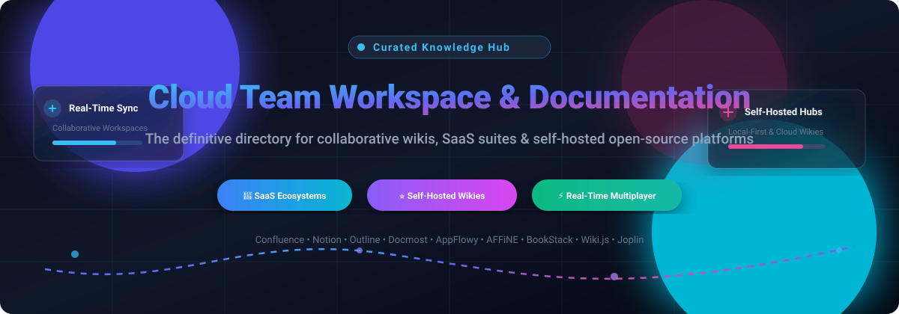
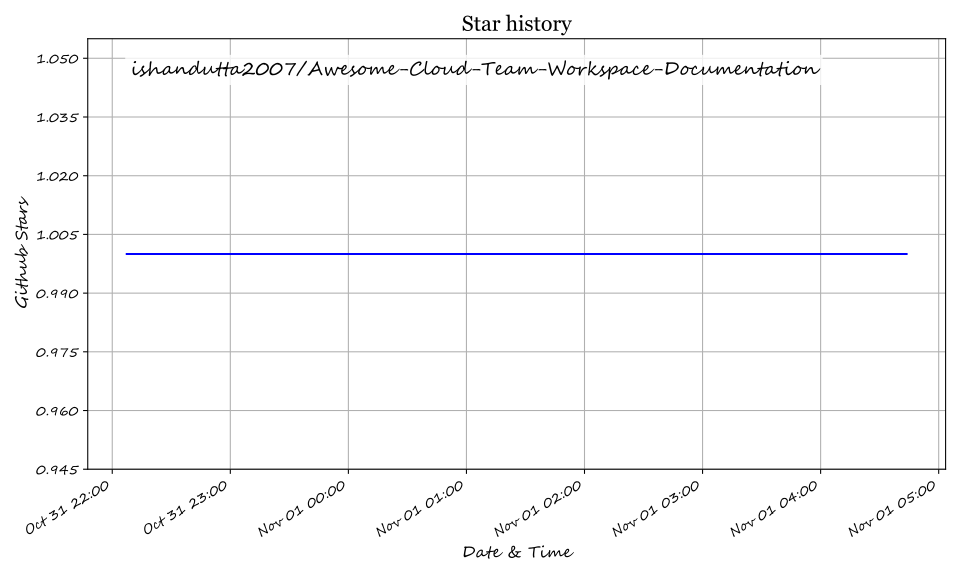

  

# 🚀 Awesome Cloud Team Workspace & Documentation

  
  
  
  
  
  
  

> 📚 A curated, opinionated list of leading SaaS platforms and top open-source GitHub projects for **Cloud Team Workspaces**, **Collaborative Wikis**, **Real-Time Knowledge Bases**, and **Self-Hosted Documentation**.

⚡ Find and evaluate the best cloud workspace software, enterprise documentation hubs, and open-source self-hosted wiki alternatives (*Notion, Confluence, Coda, Slite, Docmost, Outline, AFFiNE, AppFlowy, BookStack, Wiki.js*).

---

## 📑 Table of Contents

- [🌐 Sector Overview & Market Dynamics](#-sector-overview--market-dynamics)
- [💼 SaaS & Hosted Workspace Platforms](#-saas--hosted-workspace-platforms)
- [💻 Open-Source GitHub Projects](#-open-source-github-projects)
- [🧩 Feature Matrix & Selection Guide](#-feature-matrix--selection-guide)
- [🤝 How to Contribute](#-how-to-contribute)
- [📊 Star History](#-star-history)
- [💖 Support](#-support)
- [📜 Disclaimer](#-disclaimer)

---

## 🌐 Sector Overview & Market Dynamics

The global team collaboration and cloud workspace market is estimated at **$45B to $50B+**, rapidly scaling toward **$90B+** by the early 2030s at an estimated compound annual growth rate (CAGR) of **~10–13%** 📈. The sector is **moderately concentrated at the enterprise core**—dominated by mega-platforms like Microsoft (Teams/Loop), Atlassian (Confluence/Jira), Salesforce (Slack), and Google Workspace holding ~55–60% market share 🏢—yet remains **fiercely fragmented across agile point solutions and self-hosted open-source alternatives** 🧩 as modern product, engineering, and remote-first teams seek specialized real-time editors, local-first data ownership, and database-driven wikis.

---

## 💼 SaaS & Hosted Workspace Platforms

| Platform | Company Size (Market Cap / Valuation / Revenue) 🏢 | Starting Paid Tier Pricing 💳 | Free Tier / Free Trial Limits 🎁 | Best For & Core Focus 🎯 |
| :--- | :--- | :--- | :--- | :--- |
| **[Confluence Cloud](https://www.atlassian.com/software/confluence)** 🔷 | **$51B–$55B** Market Cap (Atlassian) / ~$6.57B Annual Revenue | **$6.40** / user / month (Standard tier) | **Free forever plan**: Up to 10 users, 2 GB file storage, unlimited spaces and pages, community support | Enterprise teams integrated deeply with Jira, Bitbucket, and the Atlassian product suite. |
| **[Notion](https://www.notion.com/)** ⬛ | **$11B** Valuation / ~$600M ARR | **$10** / user / month (billed annually) or $12/user/month (Plus tier) | **Free forever plan**: Unlimited blocks for individuals, limited collaborative block trials for teams, 5 MB file upload cap, 7-day page history | All-in-one workspace blending modular docs, relational databases, wikis, and task tracking. |
| **[monday Workdocs](https://monday.com/)** 📊 | **$4.0B–$4.5B** Market Cap / ~$1.23B Annual Revenue | **$9** / seat / month (Basic tier, 3-seat minimum = $27/mo) | **Free forever plan**: Up to 2 seats, 3 boards, 200 items, 500 MB storage; **14-day free trial** for Pro tier (no credit card required) | Teams already managing projects on Monday.com seeking collaborative docs linked to boards. |
| **[ClickUp](https://clickup.com/)** 🎯 | **$4B** Valuation / ~$300M ARR | **$7** / user / month (billed annually) or $10/user/month (Unlimited tier) | **Free forever plan**: 100 MB storage, unlimited members, unlimited docs, 60 uses of custom fields, 100 automations/mo | Teams looking to consolidate docs, wikis, sprints, roadmaps, and tasks into a single platform. |
| **[Coda](https://coda.io/)** 📄 | **$1.4B** Valuation / ~$45M–$50M ARR | **$10** / Doc Maker / month (billed annually) or $12/month (Pro tier; editors/viewers are free) | **Free forever plan**: Unlimited unshared docs, doc size limits (up to 50 objects/doc), 3-table limit per doc | Teams wanting interactive doc-spreadsheet hybrids with automated workflows and Packs. |
| **[Guru](https://www.getguru.com/)** 💡 | **~$100M–$250M** Valuation (~$68M VC funded) | **$15** / user / month (All-in-One plan, billed annually) | **30-day free trial** for enterprise/paid tiers with full AI search and verification access (no permanent free tier) | Verified internal company knowledge cards, AI enterprise search, and contextual Slack/Teams widgets. |
| **[Document360](https://document360.com/)** 📖 | **~$10M+ ARR** (Bootstrapped by Kovai.co) | **$199** / project / month (Professional tier, billed annually) | **14-day free trial** with full authoring tools, category management, and analytics (no permanent free tier) | Customer-facing technical docs, product knowledge bases, and multi-language portals. |
| **[GitBook](https://www.gitbook.com/)** 📘 | **~$3.7M–$5M ARR** (Venture-backed) | **$65** / site / month + $12/user/month (Essential tier, billed annually) | **Free forever plan**: 1 user only, public documentation on `*.gitbook.io` domain, Git sync, no custom domain | Technical documentation sites and developer APIs synced natively with GitHub and GitLab. |
| **[Slite](https://slite.com/)** ✍️ | **~$5M ARR** (~$15M total funding raised) | **$10** / user / month (billed annually) or $12/user/month (Basic tier) | **14-day free trial** with full AI search access and unlimited docs (no credit card required; no permanent free tier) | Remote-first teams wanting clean, minimal markdown wikis with built-in AI answer generation. |
| **[Slab](https://slab.com/)** 🔍 | **~$2M–$4M ARR** (Venture-backed) | **$6.67** / user / month (billed annually) or $8/user/month (Startup tier) | **Free forever plan**: Up to 10 users, 10 MB file upload limit, 90-day version history, core search | Modern engineering and product teams desiring intuitive, blazing-fast wikis with unified search. |

---

## 💻 Open-Source GitHub Projects

Sorted descending by GitHub Stars_Count ⭐:

- **[AppFlowy](https://github.com/AppFlowy-IO/AppFlowy)**  📱  
  *Open-source Notion alternative built with Flutter and Rust (AGPL-3.0).*  
  Docs, relational databases (grid, kanban, calendar), and notes in a local-first architecture with self-hosted cloud sync and AI integrations.

- **[AFFiNE](https://github.com/toeverything/AFFiNE)**  🎨  
  *Next-generation all-in-one workspace combining docs, whiteboard canvas, and database tables (MIT).*  
  True multimodal canvas that seamlessly transitions between structured docs and infinite canvas whiteboard for ideation and system design.

- **[Memos](https://github.com/usememos/memos)**  📝  
  *Privacy-first, lightweight knowledge base and note-taking service (MIT).*  
  Single-binary Go and SQLite deployment offering blazing-fast Markdown notes, tag organization, REST API, and effortless self-hosting.

- **[Plane](https://github.com/makeplane/plane)**  ✈️  
  *Open-source project management and documentation workspace (AGPL-3.0).*  
  Confluence and Jira replacement with integrated Pages (rich collaborative markdown documentation), issue tracking, cycles, and roadmaps.

- **[Joplin](https://github.com/laurent22/joplin)**  📓  
  *Secure, end-to-end encrypted note taking and team collaboration app (AGPL-3.0).*  
  Full markdown support, multimedia attachments, offline-first operation, and sync via Nextcloud, S3, WebDAV, or Joplin Server.

- **[Logseq](https://github.com/logseq/logseq)**  🧠  
  *Local-first, privacy-focused outliner and bi-directional knowledge base (AGPL-3.0).*  
  Graph-based note-taking built on plain-text Markdown and Org-mode files, featuring PDF annotations, Flashcards, and queries.

- **[Outline](https://github.com/outline/outline)**  🌐  
  *Fast, polished collaborative team wiki and knowledge base (BSL 1.1).*  
  Delivers a Notion-like UI experience, real-time multiplayer editing, Slack integrations, rich API, and enterprise-grade search. Requires OIDC/SSO.

- **[Trilium Notes](https://github.com/TriliumNext/Trilium)**  🌲  
  *Hierarchical note taking and deep personal knowledge graph platform (AGPL-3.0).*  
  Tree-structured note hierarchy with note cloning, encryption, code syntax highlighting, mind maps, and JavaScript scripting extensions.

- **[Wiki.js](https://github.com/requarks/wiki)**  📚  
  *Modern, extensible open-source wiki engine for Node.js (AGPL-3.0).*  
  Multi-editor engines (Markdown, WYSIWYG, Code), bi-directional Git storage sync, multiple database support, and public/private doc portals.

- **[Docmost](https://github.com/docmost/docmost)**  🚀  
  *Collaborative open-source wiki and documentation software (AGPL-3.0 core).*  
  Premier open-source Confluence alternative with real-time multi-user editing, spaces, nested pages, built-in email auth, and native Excalidraw/Mermaid diagrams.

- **[BookStack](https://github.com/BookStackApp/BookStack)**  📚  
  *Simple, opinionated self-hosted documentation platform (MIT).*  
  Organized intuitively by Shelves → Books → Chapters → Pages. Features built-in auth, LDAP/SAML, Diagrams.net integration, and minimal DevOps footprint.

- **[Foam](https://github.com/foambubble/foam)**  🫧  
  *Personal knowledge management and workspace system built on VS Code and GitHub (MIT).*  
  Transforms Visual Studio Code into a bi-directional networked thought environment using Markdown files and Git version control.

- **[CodiMD](https://github.com/hackmdio/codimd)**  👥  
  *Real-time collaborative Markdown knowledge sharing platform (AGPL-3.0).*  
  The open-source core of HackMD, enabling synchronous team editing on Markdown documents with mathjax, graphs, and presentation mode.

- **[HedgeDoc](https://github.com/hedgedoc/hedgedoc)**  🦔  
  *Community-driven collaborative Markdown notes platform (AGPL-3.0).*  
  Privacy-friendly, self-hosted web-based real-time Markdown editor with live preview, permissions, and flexible authentication plugins.

- **[SilverBullet](https://github.com/silverbulletmd/silverbullet)**  ⚡  
  *Extensible open-source personal knowledge management system (MIT).*  
  Clean web-based Markdown editor with live query syntax, custom page widgets, edge-first synchronization, and full offline support.

- **[DokuWiki](https://github.com/dokuwiki/dokuwiki)**  📂  
  *Standards-compliant, flat-file documentation and wiki engine (GPL-2.0).*  
  Requires zero database, operating entirely on plain text files. Features built-in ACLs, revisions, and hundreds of community plugins.

- **[Documize](https://github.com/documize/community)**  💼  
  *Modern Confluence alternative for organizing technical and business documentation (AGPL-3.0).*  
  Organizes knowledge into spaces, categories, and document snippets with enterprise permissions and change approvals.

- **[XWiki](https://github.com/xwiki/xwiki-platform)**  🏛️  
  *Advanced enterprise-grade open-source wiki and application runtime (LGPL-2.1).*  
  Extensible Java-based collaboration platform with complete scriptability, office document imports, fine-grained ACLs, and enterprise scale.

---

## 🧩 Feature Matrix & Selection Guide

- 🚀 **Need a Confluence / Notion self-hosted replacement?** → Start with **[Docmost](https://github.com/docmost/docmost)** (built-in email auth, real-time multiplayer, native diagrams) or **[Outline](https://github.com/outline/outline)** (ultra-clean Notion feel, requires OIDC SSO).
- 📊 **Need database tables & kanban views?** → Choose **[AppFlowy](https://github.com/AppFlowy-IO/AppFlowy)** (Rust/Flutter local-first) or **[AFFiNE](https://github.com/toeverything/AFFiNE)** (whiteboard + doc + table hybrid).
- 📖 **Need zero training for non-technical staff?** → Choose **[BookStack](https://github.com/BookStackApp/BookStack)** (intuitive Shelves → Books → Chapters hierarchy).
- 🛠️ **Need Git-backed public developer documentation?** → Choose **[Wiki.js](https://github.com/requarks/wiki)** (Git repository synchronization, code editors) or **[GitBook](https://www.gitbook.com/)** (hosted).
- 🏃 **Need integrated sprints & issue tracking with docs?** → Choose **[Plane](https://github.com/makeplane/plane)**.
- 🔗 **Need personal and networked thought graphs?** → Choose **[Logseq](https://github.com/logseq/logseq)**, **[Trilium Notes](https://github.com/TriliumNext/Trilium)**, or **[SilverBullet](https://github.com/silverbulletmd/silverbullet)**.

---

## 🤝 How to Contribute

1. Fork this repository 🍴.
2. Add or update entries in [README.md](file:///C:/Users/ishan/Documents/Projects/Awesome-Cloud-Team-Workspace-Documentation/README.md).
3. Ensure open-source projects include official repository links, open-source license, and Stars_Badges formatted as:
   ``
4. For SaaS tools, provide accurate pricing columns, specific starting tier numbers, and explicit free plan or free trial duration details.
5. Submit a Pull Request with a brief summary of additions or updates ✨.

---

## 📊 Star History

---

## 💖 Support

Thank you for exploring and using **Awesome Cloud Team Workspace & Documentation**! 🌟

If you find this repository helpful, please consider supporting the project:
- ⭐ **Star this repository** on GitHub to help others discover it.
- 🍴 **Fork it** and contribute your favorite open-source tools or corrections.
- 📢 **Share it** with your engineering team, developer community, or on social media.
- ☕ **Buy me a coffee**: Support ongoing curation and maintenance via the [GitHub Sponsor Dashboard](https://github.com/sponsors/ishandutta2007).

---

## 📜 Disclaimer

- This list is community-curated for informational and comparative purposes.
- Team workspaces and enterprise knowledge bases often store critical intellectual property and operational credentials. Always evaluate security policies, backup models, SSO requirements, and regulatory compliance (GDPR, SOC2, HIPAA) prior to deployment 🔒.

## ⭐ Star History

<a href="https://star-history.com/#ishandutta2007/Awesome-Cloud-Team-Workspace-Documentation&Timeline" align="center">
  <picture>
    <source media="(prefers-color-scheme: dark)" srcset="assets/ishandutta2007_Awesome-Cloud-Team-Workspace-Documentation_growth.svg">
    
  </picture>
</a>
